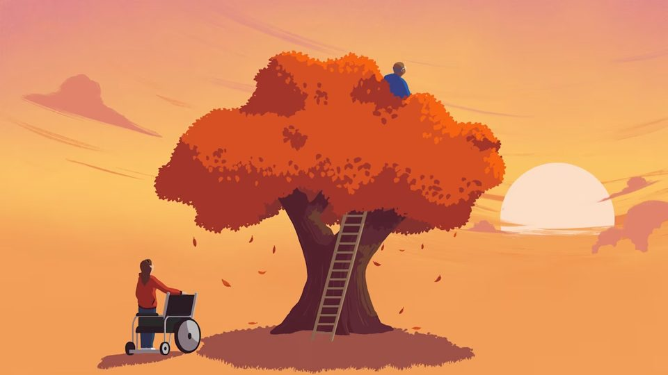

```{=html}
<div class="bdf-home">
<div class="bdf-system" id="system">
  <svg class="bdf-lines" aria-hidden="true"></svg>
  <span class="edge" data-a="L0" style="position:absolute;left:-3%;top:1.2%"></span>
  <span class="edge" data-a="R0" style="position:absolute;left:103%;top:7%"></span>
  <span class="edge" data-a="L1" style="position:absolute;left:-3%;top:47%"></span>
  <span class="edge" data-a="R1" style="position:absolute;left:103%;top:64%"></span>
  <span class="edge" data-a="L2" style="position:absolute;left:-3%;top:83%"></span>

  <section class="bdf-hero" data-sec>
    <div class="blobs" aria-hidden="true">
      <span class="blob l1" style="--c:#D3E4DB;--x:40%;--y:-6%;--w:58vw;--r:-12deg;--d:0.0s"></span>
      <span class="blob l2" style="--c:#D3E1F1;--x:-12%;--y:34%;--w:40vw;--r:18deg;--d:0.5s"></span>
      <span class="blob l3" style="--c:#FBD9D3;--x:64%;--y:28%;--w:30vw;--r:8deg;--d:1.0s"></span>
      <span class="blob l3" style="--c:#E1D8F0;--x:22%;--y:62%;--w:22vw;--r:-20deg;--d:1.5s"></span>
    </div>
    <span class="sat role" data-a="car" style="--x:64%;--y:16%;--c:#C45A3C;--d:0.50s"><i></i><span class="t">Unpaid carers</span></span>
    <span class="sat role" data-a="gp" style="--x:86%;--y:40%;--c:#4A6FA8;--d:0.85s"><i></i><span class="t">GPs</span></span>
    <span class="sat role" data-a="fam" style="--x:72%;--y:72%;--c:#7B6AA8;--d:1.20s"><i></i><span class="t">Families</span></span>
    <div class="bdf-wrap">
      <div class="copy">
        <h1><span class="name"></span> <span class="claim">Building and accelerating a better palliative and end-of-life care system that works for everyone</span></h1>
        <span class="lede">Our end-of-life care system in the UK was built for a different experience of death and dying. The  will use philanthropic money to help shift the way communities and organisations support people and families, and meet the challenges of today, and tomorrow.</span>
      </div>
    </div>
  </section>

  <section class="bdf-sec left" data-sec>
    <div class="blobs" aria-hidden="true">
      <span class="blob l1" style="--c:#D3E1F1;--x:38%;--y:-4%;--w:56vw;--r:10deg;--d:0.0s"></span>
      <span class="blob l2" style="--c:#D3E4DB;--x:62%;--y:30%;--w:32vw;--r:-20deg;--d:0.5s"></span>
      <span class="blob l3" style="--c:#F3E3C4;--x:78%;--y:64%;--w:18vw;--r:14deg;--d:1.0s"></span>
    </div>
    <span class="sat role" data-a="dn" style="--x:68%;--y:24%;--c:#2E6F5E;--d:0.50s"><i></i><span class="t">District nurses</span></span>
    <span class="sat org" data-a="ch" style="--x:84%;--y:62%;--c:#D4A24C;--d:0.85s"><i></i><span class="t">Care homes</span></span>
    <div class="bdf-wrap"><div class="copy">
      <span class="node" data-a="n1" style="--c:#C45A3C"><i></i></span>
      <h2>The ways we die have changed faster than the systems built to care for us</h2>
      <p>The patterns are clear for people caring for people coming to the end of their lives. Dementia and frailty have displaced the rapid decline from cancer that the hospice movement was built around. The final phase of life can now last years. Care homes are on track to become the most common place of death by 2040, yet they have no duty to provide end-of-life care. By then roughly 150,000 more people will need palliative care than do today. Meanwhile care in the community is getting harder, with district nursing numbers having fallen 43% since 2009.</p>
    </div></div>
  </section>

  <section class="bdf-sec right" data-sec>
    <div class="blobs" aria-hidden="true">
      <span class="blob l1" style="--c:#FBD9D3;--x:-14%;--y:0%;--w:54vw;--r:-8deg;--d:0.0s"></span>
      <span class="blob l2" style="--c:#E1D8F0;--x:12%;--y:36%;--w:34vw;--r:22deg;--d:0.5s"></span>
      <span class="blob l3" style="--c:#D3E1F1;--x:30%;--y:10%;--w:16vw;--r:-12deg;--d:1.0s"></span>
    </div>
    <span class="sat org flip" data-a="hos" style="--x:26%;--y:22%;--c:#2E6F5E;--d:0.50s"><i></i><span class="t">Hospices</span></span>
    <span class="sat role flip" data-a="dou" style="--x:24%;--y:52%;--c:#7B6AA8;--d:0.85s"><i></i><span class="t">End-of-life doulas</span></span>
    <span class="sat role flip" data-a="cn" style="--x:36%;--y:76%;--c:#C45A3C;--d:1.20s"><i></i><span class="t">Compassionate neighbours</span></span>
    <div class="bdf-wrap"><div class="copy">
      <span class="node" data-a="n2" style="--c:#2E6F5E"><i></i></span>
      <h2>Good care is in many places. It just isn’t widespread</h2>
      <p>Hospice-at-home teams, community nurses, care home staff, end-of-life doulas and compassionate neighbours are doing remarkable work up and down the country. Despite incredibly challenging conditions, the field is full of energy for change. But we have heard the same thing again and again: people hit a ceiling. Innovations can’t scale beyond the place that built them because the conditions aren’t right elsewhere, and the people who kickstarted them have to move on to the next funding bid, whilst the wider staff get back to their busy workloads.</p>
    </div></div>
  </section>

  <section class="bdf-sec left" data-sec>
    <div class="blobs" aria-hidden="true">
      <span class="blob l1" style="--c:#E1D8F0;--x:42%;--y:-6%;--w:56vw;--r:14deg;--d:0.0s"></span>
      <span class="blob l2" style="--c:#D3E1F1;--x:66%;--y:40%;--w:30vw;--r:-6deg;--d:0.5s"></span>
      <span class="blob l3" style="--c:#D3E4DB;--x:56%;--y:12%;--w:16vw;--r:20deg;--d:1.0s"></span>
    </div>
    <span class="sat role" data-a="cns" style="--x:64%;--y:20%;--c:#4A6FA8;--d:0.50s"><i></i><span class="t">Community nurse specialists</span></span>
    <span class="sat org" data-a="hosp" style="--x:86%;--y:48%;--c:#0F2B26;--d:0.85s"><i></i><span class="t">Hospitals</span></span>
    <span class="sat org" data-a="icb" style="--x:70%;--y:78%;--c:#7B6AA8;--d:1.20s"><i></i><span class="t">Integrated care boards</span></span>
    <div class="bdf-wrap"><div class="copy">
      <span class="node" data-a="n3" style="--c:#4A6FA8"><i></i></span>
      <h2>It is difficult to get good work to grow long-term</h2>
      <p>New approaches run out of grant money before they can produce the evidence that would justify keeping them. The benefits of improved care in one part of the system often land in someone else’s budget, so no one has a reason to pay for it. The information that would let care follow a person from home to hospice to hospital to care home is largely missing. Every organisation can improve its own part, but no organisation is set up to fix the joins.</p>
    </div></div>
  </section>

  <section class="bdf-sec right" data-sec>
    <div class="blobs" aria-hidden="true">
      <span class="blob l1" style="--c:#F3E3C4;--x:-12%;--y:4%;--w:52vw;--r:-14deg;--d:0.0s"></span>
      <span class="blob l2" style="--c:#D3E4DB;--x:16%;--y:40%;--w:32vw;--r:16deg;--d:0.5s"></span>
      <span class="blob l3" style="--c:#FBD9D3;--x:6%;--y:62%;--w:18vw;--r:-8deg;--d:1.0s"></span>
    </div>
    <span class="sat org flip" data-a="fdn" style="--x:30%;--y:26%;--c:#D4A24C;--d:0.50s"><i></i><span class="t">Charitable foundations</span></span>
    <span class="sat org flip" data-a="la" style="--x:24%;--y:70%;--c:#0F2B26;--d:0.85s"><i></i><span class="t">Local authorities</span></span>
    <div class="bdf-wrap"><div class="copy">
      <span class="node" data-a="n4" style="--c:#D4A24C"><i></i></span>
      <h2>There is real generosity, but almost none of it is aimed at changing how the system works</h2>
      <p>Over the past ten years, major charitable foundations have given about £92m to end-of-life care for adults, spread across 3,500 separate grants, and most of that has gone on keeping existing services running. That support matters, but it means charitable money has mostly been used to prop up today’s system rather than improve it. Philanthropy has freedoms that public money lacks. It can pay for work that crosses the boundaries between hospices, hospitals, care homes and local communities. It can stay involved for the years it takes to find out whether something works. And it can be set up from the start to hand over to others once it does. Used that way, a relatively small amount of money can change far more than its size suggests.</p>
    </div></div>
  </section>

  <section class="bdf-sec left" data-sec>
    <div class="blobs" aria-hidden="true">
      <span class="blob l1" style="--c:#FBD9D3;--x:40%;--y:-4%;--w:56vw;--r:6deg;--d:0.0s"></span>
      <span class="blob l2" style="--c:#E1D8F0;--x:64%;--y:34%;--w:32vw;--r:-18deg;--d:0.5s"></span>
      <span class="blob l3" style="--c:#D3E4DB;--x:46%;--y:58%;--w:20vw;--r:12deg;--d:1.0s"></span>
    </div>
    <span class="sat role" data-a="phil" style="--x:70%;--y:24%;--c:#C45A3C;--d:0.50s"><i></i><span class="t">Philanthropists</span></span>
    <span class="sat role" data-a="vol" style="--x:84%;--y:66%;--c:#2E6F5E;--d:0.85s"><i></i><span class="t">Volunteers</span></span>
    <div class="bdf-wrap"><div class="copy">
      <span class="node" data-a="n5" style="--c:#0F2B26"><i></i></span>
      <h2>The </h2>
      <p>We are working with philanthropic donors to bring new resources into end-of-life care: a different kind of capital designed to accelerate what already works, build new approaches, and build the shared capabilities no single organisation can.</p>
      <p>We’ve started with a major report that maps where the system is stuck and identifies five places where we believe this money can make the biggest difference.</p>
      <p>The fund is being built by ZIP, an innovation agency with a track record of building ventures to enable healthy ageing and support the care system. We’re working in partnership with Purposeful Ventures, a major charity that backs social entrepreneurs, and Ivor Williams, end-of-life care designer and former Lead for End-of-Life Care at Imperial College London.</p>
      <a class="btn-bdf" href="report/index.html">Read the report →</a>
    </div></div>
  </section>
</div>


<section class="bdf-press-sec" data-sec>
  <div class="bdf-wrap">
    <h2> in the press</h2>
    <a class="bdf-article" href="https://www.ft.com/content/900ff462-3cbb-41af-9a29-1e4aa3d0ab4e" target="_blank" rel="noopener">
      <figure></figure>
      <span class="credit">Illustration © Andy Carter</span>
      <span class="meta">Polly Mackenzie · 13 October 2026</span>
      <span class="title">Why we need a proper conversation about death</span>
      <span class="sub">Philanthropy needs to step up to meet the needs that a National Care Service never will</span>
      <span class="more">Read in the Financial Times →</span>
    </a>
  </div>
</section>
<section class="bdf-involve" id="get-involved" data-sec>
  <div class="bdf-wrap"><div class="box">
    <h2>Help shape what comes next</h2>
    <p class="intro">Our report is the beginning of a process to co-design the investments the  will make. Over the coming months we are bringing together funders, practitioners and the wider public to test these ideas and decide what to back first. Register your interest to follow the work and find out how to take part.</p>
    <!-- HubSpot (Zinc). Still to add when Zinc sends them:
         data-hubspot-role-field = internal name of the "Role" checkbox property (role answers are not sent until then)
         data-hubspot-subscription = ID of the "Better Dying Fund updates" subscription type -->
    <form class="bdf-form" id="interest-form" method="POST" novalidate
          data-hubspot-portal="19602412" data-hubspot-form="f8a13b36-e6e0-4bc8-b30b-5197a32434ec"
          data-hubspot-role-field="" data-hubspot-subscription=""
          data-fallback-email="polly@zinc.vc">
      <div class="body">
        <div class="grid">
          <div class="field">
            <label for="f-first">First name</label>
            <input id="f-first" name="firstname" type="text" autocomplete="given-name" required>
          </div>
          <div class="field">
            <label for="f-last">Last name</label>
            <input id="f-last" name="lastname" type="text" autocomplete="family-name" required>
          </div>
          <div class="field">
            <label for="f-email">Email</label>
            <input id="f-email" name="email" type="email" autocomplete="email" required>
          </div>
          <div class="field">
            <label for="f-company">Company or organisation <span class="opt">Optional</span></label>
            <input id="f-company" name="company" type="text" autocomplete="organization">
          </div>
        </div>
        <fieldset class="roles">
          <legend>I am… <span class="opt">Tick all that apply</span></legend>
          <label class="tick"><input type="checkbox" name="role" value="Funder"><span>A funder</span></label>
          <label class="tick"><input type="checkbox" name="role" value="Working in end-of-life care"><span>Working in end-of-life care</span></label>
          <label class="tick"><input type="checkbox" name="role" value="Other"><span>Other</span></label>
        </fieldset>
        <input type="text" name="_gotcha" class="hp" tabindex="-1" autocomplete="off" aria-hidden="true">
        <p class="err" id="f-err" role="alert"></p>
        <p class="status" role="status" aria-live="polite"></p>
        <button type="submit" class="btn-bdf">Keep me updated by email</button>
        <p class="fine">We’ll only use your details to send you updates about the Better Dying Fund. Your details are held by Zinc Innovation Partners, and you can unsubscribe at any time. <a href="privacy.html">Privacy notice</a>.</p>
      </div>
      <div class="done" hidden tabindex="-1"><p><strong>Thank you.</strong> We’ll be in touch as the work develops.</p></div>
    </form>
  </div></div>
</section>
</div>
<script src="assets/home.js?v=1792017200" defer></script>
```
